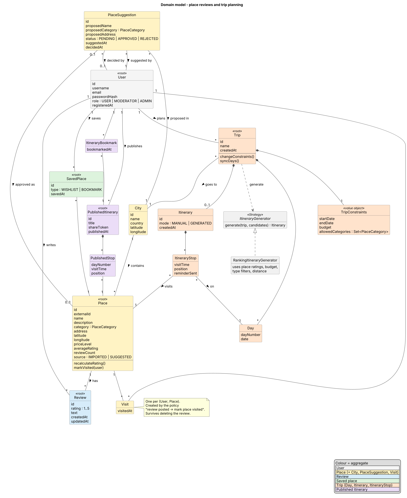

# Design – Iteration 0

Group 7 · MESW LES / DOO 2026-27

This page is the entry point for the design deliverables of Iteration 0. Every
deliverable below is stored in this repository and linked from here.

| Deliverable | Status | Location |
|---|---|---|
| EventStorming model | Done | [EventStorming](#1-eventstorming) |
| UML domain model | Done | [Domain model](#2-domain-model) |
| UML component diagram | Done | [Component diagram](#3-component-diagram) |

---

## 0. Product summary

A web app for reviewing and ranking places (Letterboxd / TripAdvisor style) with
built-in trip planning. The user gives a city and a number of days, and gets a
day-by-day itinerary, built manually or suggested automatically from rankings,
reviews, budget and place type.

---

## 1. EventStorming

- **Overview:** 
- **Editable source:** [eventstorming.drft](design/eventstorming.drft) (draw.io)

Legend: orange = event, blue = command, purple = policy, pink = external system,
yellow (small) = actor, green = view / read model, yellow (tall) = aggregate.

### Aggregates

| Aggregate | Responsibility |
|---|---|
| User | Registration |
| Place | Catalog (imports and approved suggestions), rating, visited marker, top-rated places |
| Review | Post, edit and delete reviews |
| Trip | Constraints, days, itinerary, assigned places, visit times, reminders |
| Saved place | Wishlist ("I want to go there") and bookmarks ("remember for later") |
| Published itinerary | Publishing, bookmarking published itineraries |

### External systems

- **Places data source** (OpenStreetMap or a Places API) feeds *Import places*.
- **Notification service** delivers visit reminders.

### Key decisions

- Places come from imports for the MVP. User suggestions go through moderation.
- Posting a review marks the place as visited. Deleting the review does not unmark it.
- A trip owns its days. Days are derived from the trip date range and are added or
  removed by a policy whenever the constraints change.
- An itinerary is created either manually or generated by the system. Both end in
  *Itinerary created*.
- Deleting a day removes its assigned places. Deleting a trip removes its days,
  itinerary and assigned places.
- The rating is recalculated whenever a review is posted, changed or deleted, and
  the top-rated places are refreshed afterwards.
- Wishlist and bookmark are kept separate. The wishlist feeds the itinerary generator.

---

## 2. Domain model

- **Diagram:** 
- **Source:** [domain-model.puml](design/domain-model.puml) (PlantUML)

Colours in the diagram match the aggregates from the EventStorming.

| Class | Aggregate | Key attributes | Main associations |
|---|---|---|---|
| User | User | username, email, role (USER / MODERATOR / ADMIN) | writes Reviews, saves Places, plans Trips, publishes Itineraries |
| Place | Place | name, category, address, lat/long, priceLevel, averageRating, reviewCount, source; recalculateRating(), markVisited(user) | belongs to a City, has Reviews and Visits |
| City | Place | name, country, lat/long | contains Places, destination of Trips |
| PlaceSuggestion | Place | proposed data, status (PENDING / APPROVED / REJECTED) | suggested by a User, decided by a moderator, proposed in a City, approved as a Place |
| Review | Review | rating (1..5), text, createdAt, updatedAt | written by a User about a Place |
| Visit | Place | visitedAt | links a User to a Place (one per pair); created by a policy when a review is posted |
| SavedPlace | Saved place | type (WISHLIST / BOOKMARK), savedAt | User saves a Place |
| Trip | Trip | name, createdAt | owned by a User, goes to a City |
| TripConstraints (value object) | Trip | startDate, endDate, budget, allowedCategories | part of Trip |
| Day | Trip | dayNumber, date | part of Trip, derived from the date range |
| Itinerary | Trip | mode (MANUAL / GENERATED), createdAt | part of Trip (0..1) |
| ItineraryStop | Trip | visitTime, position, reminderSent | on a Day, visits a Place |
| PublishedItinerary | Published itinerary | title, shareToken, publishedAt | published by a User, copy of an itinerary (PublishedStop) |
| ItineraryBookmark | Published itinerary | bookmarkedAt | User bookmarks a PublishedItinerary |
| ItineraryGenerator (Strategy) | domain service | generate(trip, candidates) | RankingItineraryGenerator is the first implementation |

Design notes:

- Wishlist and bookmark are one class with a type, because they behave the same.
  Only the wishlist feeds the generator.
- Days are owned by the Trip and recalculated when the constraints change.
  Deleting a Trip deletes its Days, Itinerary and stops.
- A published itinerary is a copy, so it survives the deletion of the original trip.
- *Top-rated places* is a read model (a query), not a class. The rating itself
  (`averageRating`, `reviewCount`) is stored on Place.
- Visit belongs to the Place aggregate, as on the EventStorming board. The Review
  aggregate only triggers it through a policy, so deleting a review does not remove
  the Visit.
- An approved PlaceSuggestion creates a Place (source = SUGGESTED) in the city
  it was proposed in.

---

## 3. Component diagram

- **Diagram:** 
- **Source:** [component-diagram.puml](design/component-diagram.puml) (PlantUML)

| Component | Responsibility | Depends on |
|---|---|---|
| Web App | Browser UI for users, moderators and admins | Backend REST API |
| Identity | Users, authentication, roles | Database |
| Place Catalog | The whole Place aggregate: places, city search, suggestions and moderation, import, visited marker, rating recalculation and the top-rated list | Database, Places data source (external) |
| Reviews | Post, edit and delete reviews. Triggers *mark place visited* and *recalculate rating* in Place Catalog | Place Catalog |
| Saved Places | Wishlist and bookmarks | Place Catalog |
| Trip Planner | Trips, days, itineraries, visit times | Place Catalog, Itinerary Generator |
| Itinerary Generator | Builds an itinerary from top-rated places, budget, type filters and the wishlist (Strategy pattern) | Place Catalog, Saved Places |
| Publishing | Published itineraries, sharing, bookmarks | Trip Planner |
| Reminders | Scheduler that sends visit reminders | Trip Planner, Notification service (external) |

External systems:

- **Places data source** (OpenStreetMap or a Places API), used by Place Catalog to import places.
- **Notification service** (e-mail or push), used by Reminders.

Each component matches an aggregate from the EventStorming (Identity = User, Place
Catalog = Place, Reviews = Review, Saved Places = Saved place, Trip Planner = Trip,
Publishing = Published itinerary). The Itinerary Generator is the domain service
and Reminders is the timer-driven policy.

