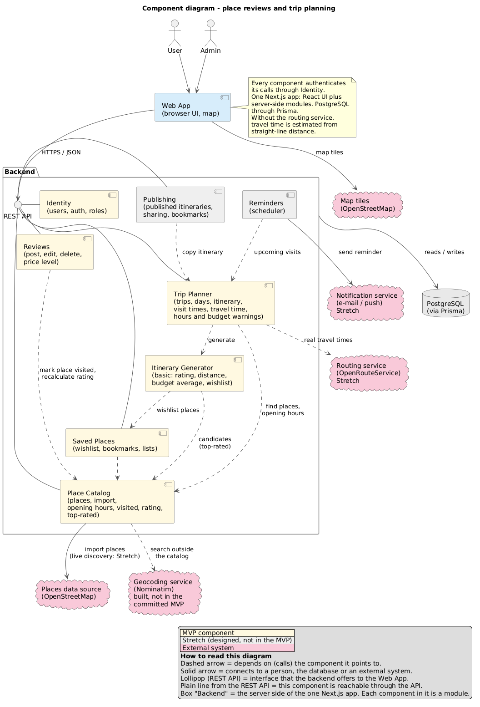
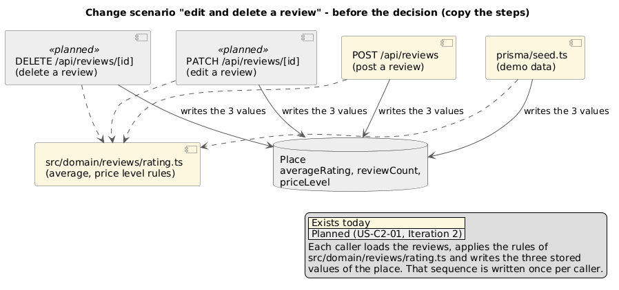
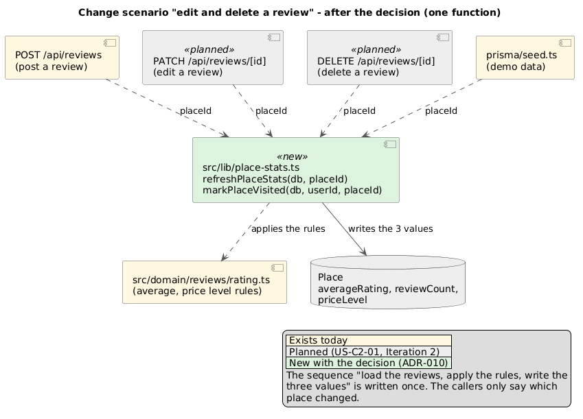

# Design Report — Tripbook

Group 7 · MESW LES / DOO 2026-27

This report is kept in `docs/design.md` and updated throughout the semester. Every model, diagram and code
location it refers to is stored in this repository and linked from here.

| Section | What it contains |
| ------- | ---------------- |
| [1. Project overview](#1-project-overview) | What the application is and where its scope is described |
| [2.1. EventStorming results](#21-eventstorming-results) | The EventStorming model: subdomains, aggregates, policies, external systems and key decisions |
| [2.2. Domain model](#22-domain-model) | The UML class diagram of the problem, and how to read it |
| [3. High-level architecture](#3-high-level-architecture) | The UML component diagram, the technology and the architecture decision records (ADRs) |
| [4. Future change scenarios](#4-future-change-scenarios-coupling-cohesion-and-design-decisions) | Plausible future changes, with their coupling and cohesion analysis and the design decision |
| [5. Existing design pattern instances](#5-existing-design-pattern-instances) | Design patterns found in the code |
| [6. Existing code smells and possible refactorings](#6-existing-code-smells-and-possible-refactorings) | Code smells found in the code, and how to refactor them |

Other documents: the [glossary](GLOSSARY.md) (ubiquitous language), [deployment.md](deployment.md) (Vercel and
Neon, see also [ADR-007](#adr-007-deployment-on-vercel-and-neon)), [mvp.md](mvp.md) and [vision.md](vision.md).

## 1. Project overview

A web app for reviewing and ranking places (Letterboxd / TripAdvisor style) with
built-in trip planning. The user gives a city and dates, and gets a
day-by-day itinerary, built manually or suggested automatically from rankings,
reviews, budget and place type.

What is in the MVP and what is not: see [mvp.md](mvp.md) and [vision.md](vision.md). The terms used in this
report are defined in the [glossary](GLOSSARY.md).

## 2. Domain discovery and modeling

### 2.1. EventStorming results

- **Overview:** 
- **Editable source:** [eventstorming.drft](design/eventstorming.drft) (draft.io)

The board follows the Process Modelling format from the DOO slides. Each cluster
reads left to right: actors, then commands, then the aggregate, then the events it
produces. Not every event has a command of its own (for example _Days added_ follows
_Create trip_). Policies are the only links between aggregates. The grey outlines
are subdomains. Dashed frames and grey "Post MVP" notes mark what is not in the MVP.

Legend: orange = event, blue = command, purple = policy, red = external system,
yellow (small) = actor, yellow (tall) = aggregate, pink = open issue, grey = note.

**Change after the board was drawn.** On 12 Nov 2026 the budget level and the hour limits moved from the trip to its itinerary, where they are optional (a trip is a name, a city and dates, created together with its days and an empty itinerary), and the types of place became an input of _Generate itinerary_. The command _Change trip constraints_ is therefore _Change trip dates_ and the event _Trip constraints changed_ is _Trip dates changed_. The board image and its draft.io source still show the old names and are not redrawn; the tables here and the [domain model](#22-domain-model) are the current ones.

#### Subdomains

| Subdomain         | Aggregates                                                      |
| ----------------- | --------------------------------------------------------------- |
| Trip planning     | Trip, Published itinerary (Stretch), Reminder (Stretch)         |
| Places and reviews | Place, Review, Place suggestion (Dream)                        |
| User space        | User, Saved places, List                                        |

#### Aggregates

| Aggregate           | Commands                                                                                         | Events                                                                                                                                                                | Tier                                        |
| ------------------- | ------------------------------------------------------------------------------------------------ | --------------------------------------------------------------------------------------------------------------------------------------------------------------------- | ------------------------------------------- |
| User                | Register user                                                                                    | User registered                                                                                                                                                       | MVP                                         |
| Trip                | Create trip, Change trip dates, Generate itinerary, Edit itinerary (assign or remove a place, set a visit time, set the optional budget level and hour limits), Delete trip | Trip created, Trip dates changed, Days added, Days removed, Itinerary generated, Plan warning raised, Place assigned to day, Place removed from day, Visit time set, Trip deleted | MVP                                         |
| Place               | Import places, Mark place visited, Recalculate rating and price level, Add place to catalog      | Places imported, Place visited, Place rating and price level updated, Place added to catalog                                                                          | MVP (_Add place to catalog_ is Dream)       |
| Review              | Post review, Edit review, Delete review                                                          | Review posted, Review changed, Review deleted                                                                                                                         | MVP                                         |
| Saved places        | Wishlist place, Bookmark place, Remove saved place                                               | Place wishlisted, Place bookmarked, Place removed from wishlist, Place removed from bookmarks                                                                         | MVP                                         |
| List                | Add or remove place, Create list, Change list (rename or delete)                                 | Place added to list, Place removed from list, List created, List renamed, List deleted                                                                                | MVP                           |
| Published itinerary | Publish itinerary, Bookmark published itinerary, Remove itinerary bookmark                       | Itinerary published, Itinerary bookmarked, Itinerary bookmark removed                                                                                                 | Stretch                                     |
| Reminder            | Send a reminder                                                                                  | Visit reminder sent                                                                                                                                                   | Stretch                                     |
| Place suggestion    | Suggest place, Approve suggestion, Reject suggestion                                             | Place suggested, Suggestion approved, Suggestion rejected                                                                                                             | Dream                                       |

#### Policies

| Policy                                                                                        | From aggregate   | To aggregate | Tier    |
| --------------------------------------------------------------------------------------------- | ---------------- | ------------ | ------- |
| Whenever a review is posted, mark the place as visited                                        | Review           | Place        | MVP     |
| Whenever a review is posted, changed or deleted, the rating and price level are recalculated  | Review           | Place        | MVP     |
| Whenever a place is removed from bookmarks, remove it from the user's lists                   | Saved places     | List         | MVP |
| When a visit time is near, send a reminder                                                    | Trip             | Reminder     | Stretch |
| Whenever a suggestion is approved, add the place to the catalog                               | Place suggestion | Place        | Dream   |

#### External systems and actors

- **Places data source** (OpenStreetMap) feeds _Import places_, triggered by an admin.
- **Map tiles** (OpenStreetMap) are used by the web app to draw the map. They are not tied to a command.
- **Notification service** delivers visit reminders (Stretch). The trigger is a timer.
- **Routing service** provides real travel times on foot, by car and by public transport (Stretch). The provider is chosen later.
- **Moderator** (a user with the ADMIN role) approves or rejects place suggestions (Dream).
- **Geocoding service** (Nominatim) finds places outside the catalog (built, outside the committed MVP, see ADR-004).

#### Key decisions

- The board is conceptual. A trip owns its days and its itinerary, so Day and
  Itinerary are not separate aggregates. The rules about days, assigned places,
  opening hours, the hour limits and budget live inside Trip (its itinerary), so they are not policies.
- Places come from OpenStreetMap through the import and seed scripts for three cities
  (Porto, Paris and Berlin). Live discovery on the map, where a discovered place is
  saved to the catalog when it is first reviewed, is built in the tracer bullet but is
  Stretch (see ADR-002). The board does not show it yet: treat the saving as part of
  _Post review_ until the board is updated. User suggestions with moderation (Place
  suggestion) are designed but not in the MVP.
- Posting a review is the only way a place is marked as visited. Deleting the
  review does not unmark it.
- A user can review a given place only once (a unique index on the user and the
  place); to change an opinion they edit the review. Different users can each
  review the same place.
- Days follow the trip date range: _Days added_ and _Days removed_ are events of
  _Create trip_ and _Change trip dates_, with no command of their own.
- An itinerary is either generated by the system (_Generate itinerary_) or built by
  hand (_Edit itinerary_). The MVP generator is a basic one; a smarter one is Stretch.
- Deleting a day removes its assigned places. Deleting a trip removes its days,
  itinerary and assigned places.
- The rating and price level are recalculated whenever a review is posted, changed
  or deleted. _Top-rated places_ is a query, not an event.
- Wishlist and bookmark are kept separate. The wishlist feeds the itinerary
  generator (it reads it, no event). Lists are made of bookmarked places, so
  removing a bookmark removes the place from the lists.
- OpenStreetMap has no ratings or price levels, so reviewers provide the price level
  and the seed script creates demo users and reviews, so that rankings work from day one.
  A place's price level is the most common (mode) price level of its reviews, but a place
  that OpenStreetMap tags `fee=no` is free and stays free until at least 2 reviews give a paid price.
- Opening hours come from OpenStreetMap when mapped. Where they are missing the app
  shows "unknown" and cannot warn.
- Travel time between stops is estimated from straight-line distance in the MVP.
  Real routing is Stretch.
- The budget level is a soft target for the average price of the whole trip. Places
  have cost points (free 0, € 1, €€ 2, €€€ 3). The generator keeps the running average
  near the budget level and always includes wishlist places; the planner shows the
  average and warns when it is above. The budget level is optional in a manual itinerary and required to generate. There is no euro amount. See [mvp.md](mvp.md#4-data-for-the-mvp).
- A place can be in several lists, and a list can hold any bookmarked place.
- A published itinerary is a copy, so it survives the deletion of the original trip.

What is in the MVP and what is not: see [mvp.md](mvp.md) and [vision.md](vision.md).

### 2.2. Domain model

- **Diagram:** 
- **Source:** [domain-model.puml](design/domain-model.puml) (PlantUML)

The domain model **defines the problem**: the concepts of the business, their data and
how they relate. It has no technical ids and no behaviour. How the problem is solved
(components, patterns, technology) is in the [component diagram](#31-component-diagram).
Terms are defined in the [glossary](GLOSSARY.md).

**How to read the diagram** (the same legend is inside the diagram):

| Notation                          | Meaning                                                                                              |
| --------------------------------- | ---------------------------------------------------------------------------------------------------- |
| Box colour                        | Aggregate, as on the EventStorming board: the classes that change together                            |
| Line with a filled diamond        | Composition: the part cannot exist without the whole and is deleted with it                         |
| `/attribute`                      | Derived: calculated from other data, not typed in                                                    |
| `attribute [0..1]`                | Optional: may be unknown                                                                             |
| `<<value object>>`                | Has no identity of its own, defined only by its values                                               |
| `<<enumeration>>`                 | Fixed set of allowed values, shared by several classes                                               |
| `<<post-MVP>>`                    | Designed, not in the MVP                                                                             |

| Class                          | Aggregate           | Key attributes                                                                               | Main associations                                                                         |
| ------------------------------ | ------------------- | -------------------------------------------------------------------------------------------- | ----------------------------------------------------------------------------------------- |
| User                           | User                | username, email, role (USER / ADMIN)                                                         | writes Reviews, makes Visits, saves Places, owns Lists, plans Trips. An ADMIN is also the moderator of suggestions |
| City                           | Place               | name, country, latitude, longitude, timezone                                                           | contains Places, destination of Trips                                                     |
| Place                          | Place               | name, description, category, address, latitude, longitude, openingHours (optional), /priceLevel, /averageRating, /reviewCount | belongs to a City, has Reviews and Visits                       |
| Visit                          | Place               | visitedAt                                                                                    | links a User to a Place (at most one per pair); created when the user posts a review      |
| PlaceSuggestion (post-MVP)     | Place suggestion    | proposedName, proposedCategory, proposedAddress, status, suggestedAt, decidedAt (optional)   | suggested by a User, decided by a moderator (ADMIN), proposed in a City, approved as a Place |
| Review                         | Review              | rating (1..5), priceLevel (FREE, €, €€ or €€€; required when posted), text, createdAt                                        | written by a User about a Place (a user reviews a given place at most once)               |
| SavedPlace                     | Saved places        | type (WISHLIST / BOOKMARK)                                                                   | a User saves a Place                                                                      |
| SavedList                      | List                | name                                                                                         | owned by a User, contains bookmarked SavedPlaces                                          |
| Trip                           | Trip                | name, startDate, endDate                                                                     | owned by a User, goes to a City, has Days and one Itinerary                               |
| Day                            | Trip                | dayNumber, date                                                                              | part of a Trip, one per date between the start and end date                               |
| Itinerary                      | Trip                | mode (MANUAL / GENERATED), budgetLevel (optional, €, €€ or €€€: target average price of the whole trip), dayStart and dayEnd (optional hour limits), /averageCostPoints | part of a Trip (exactly one, created empty with it), schedules ItineraryStops |
| ItineraryStop                  | Trip                | visitTime (optional), position, /outsideOpeningHours, /travelTimeFromPreviousStop            | on a Day, visits a Place                                                                  |
| Reminder (post-MVP)            | Reminder            | sentAt                                                                                       | reminds of an ItineraryStop; created when the visit time is near                          |
| PublishedItinerary (post-MVP)  | Published itinerary | title, publishedAt                                                                           | published by a User, bookmarked by Users, has PublishedStops (a copy of an itinerary)     |
| PublishedStop (post-MVP)       | Published itinerary | dayNumber, visitTime (optional), position                                                    | visits a Place                                                                            |
| PriceLevel (enumeration)       | shared              | FREE = 0, € = 1, €€ = 2, €€€ = 3 (cost points)                                               | used by Place and Review (all four values); the budget level of an itinerary uses € to €€€; unknown is not counted                         |
| PlaceCategory (enumeration)    | shared              | RESTAURANT, MUSEUM, MONUMENT, PARK, CAFE, BAR, OTHER                                         | used by Place and PlaceSuggestion (the types chosen for a generation are not saved)                                        |

Design notes:

- The model leaves out on purpose what belongs to the solution: technical ids, the
  stored password hash (kept by the authentication library, ADR-009), the share token, the OpenStreetMap id and the origin of a
  place, and all operations. The database schema and the components add them.
- Wishlist and bookmark are one class with a type, because they behave the same.
  Only the wishlist feeds the itinerary generator.
- A list is its own aggregate and holds bookmarked places only. A policy removes a
  place from the lists when its bookmark is removed, and one place can be in several
  lists.
- Days are part of the Trip and follow its date range. Deleting a Trip deletes its
  Days, Itinerary and stops. This is inside the aggregate, not a policy.
- A published itinerary is a copy, so it survives the deletion of the original trip.
- _Top-rated places_ is a read model (a query), not a class. `/averageRating`,
  `/reviewCount` and `/priceLevel` are derived from the reviews of the place (the
  price level is free when OpenStreetMap says there is no fee, and it stays free
  until 2 reviews give a paid price; otherwise it is the most common price level in
  the reviews).
- Visit belongs to the Place aggregate, as on the EventStorming board. The Review
  aggregate only triggers it through a policy, so deleting a review does not remove
  the Visit.
- Place suggestion is its own aggregate (Dream). When a suggestion is approved, a
  policy adds a Place to the catalog in the city it was proposed in.

## 3. High-level architecture

### 3.1. Component diagram

- **Diagram:** 
- **Source:** [component-diagram.puml](design/component-diagram.puml) (PlantUML)

The component diagram is **the solution**: how the system is built to solve the problem
described by the [domain model](#22-domain-model). Green components are built (end of
Iteration 1), yellow ones are MVP and not built yet, grey ones are Stretch: designed,
not in the MVP.

**How to read the diagram** (the same legend is inside the diagram):

| Notation                         | Meaning                                                                          |
| -------------------------------- | -------------------------------------------------------------------------------- |
| Box with the component icon      | A component: a module with one responsibility                                    |
| Dashed arrow                     | Depends on: the component at the tail calls the one at the arrow                 |
| Solid arrow                      | Connects to a person, the database or an external system                         |
| Lollipop (REST API)              | An interface that the backend offers to the Web App                              |
| Plain line from the REST API     | The component is reachable through the API                                       |
| Box "Backend"                    | The server side of the one Next.js app. Each component inside is a module        |
| Pink cloud                       | External system we do not build                                                  |
| Cylinder                         | The database                                                                     |

| Component            | Responsibility                                                                                                                                                               | Depends on                                                              |
| -------------------- | ---------------------------------------------------------------------------------------------------------------------------------------------------------------------------- | ----------------------------------------------------------------------- |
| Web App (built)      | Browser UI for users and admins, including the map and the place page                                                                                                         | Backend REST API, Map tiles (external)                                  |
| Identity (built)     | Users, authentication (Better Auth, see ADR-009), roles                                                                                                                                                 | Database                                                                |
| Place Catalog (built) | The whole Place aggregate: places, city search, import, opening hours, visited marker, rating recalculation and the top-rated list (live discovery of places and search outside the catalog are built but outside the committed MVP; suggestions and moderation are post-MVP) | Database, Places data source (external), Geocoding service (external) |
| Reviews (post built; edit and delete not yet) | Post, edit and delete reviews, including the price level. Triggers _mark place visited_ and _recalculate rating_ in Place Catalog (ADR-010 puts both policies in one function)                                            | Place Catalog                                                           |
| Saved Places         | Wishlist, bookmarks and custom lists                                                                                                                                         | Place Catalog                                                           |
| Trip Planner         | Trips, days, itineraries with their optional budget level and hour limits, visit times, travel-time estimates, opening-hours, hour-limit and budget warnings                                                | Place Catalog, Itinerary Generator, Routing service (external, Stretch) |
| Itinerary Generator  | Builds a basic itinerary from top-rated places, type filters, distance, the budget average, the wishlist, the hour limits given for the generation and known opening hours.                           | Place Catalog, Saved Places                                             |
| Import and seed scripts (built) | The command line side of Place Catalog: imports the places of a city from OpenStreetMap into a snapshot and the database, and loads the demo users, places and sample reviews. They are run by hand and reuse the rules of `src/domain` | Database, Geocoding service (external), Place Catalog rules |
| Publishing (Stretch) | Published itineraries, sharing, bookmarks                                                                                                                                    | Trip Planner                                                            |
| Reminders (Stretch)  | Scheduler that sends visit reminders                                                                                                                                         | Trip Planner, Notification service (external)                           |

External systems:

- **Places data source** (OpenStreetMap, Overpass), used by Place Catalog to discover places live on the map, outside the committed MVP (see ADR-002).
- **Map tiles** (OpenStreetMap), used by the Web App to draw the map.
- **Routing service** (Stretch, provider chosen later), used by Trip Planner for real travel times.
- **Geocoding service** (Nominatim), used by the import script to load the places of a city (MVP), and, built but outside the committed MVP, by Place Catalog to search outside the catalog (see ADR-002 and ADR-004).
- **Notification service** (e-mail or push, Stretch), used by Reminders.

Each component matches aggregates from the EventStorming (Identity = User, Place
Catalog = Place and Place suggestion, Reviews = Review, Saved Places = Saved places
and List, Trip Planner = Trip, Publishing = Published itinerary, Reminders =
Reminder). The Itinerary Generator is the domain service. The policies on the board
are the calls between components: Reviews to Place Catalog (visited and rating),
Saved Places to itself (lists), Trip Planner to Reminders.

### 3.2. Technology

The app is one Next.js project: the React UI and the server side
(route handlers) live in the same codebase, and each backend component above is a
module of it. Data is stored in PostgreSQL through Prisma, with versioned Prisma
migrations. The target setup is development in VS Code inside a dev container, with
one container for the app and one for the database (planned; today
Docker Compose runs only the database and the app runs on the developer's machine).
The MVP is one deployable app plus one database.

### 3.3. Architecture decision records (ADRs)

The structuring architecture decisions of the project are kept in this section, so
there are no separate files to keep in sync. This section is the single source of
truth. Domain policies are on the EventStorming board and in section 2.1.

| ADR     | Decision                                                  | Status                |
| ------- | --------------------------------------------------------- | --------------------- |
| ADR-001 | Full-stack architecture with Next.js 15 App Router       | Accepted              |
| ADR-002 | Places come from import and seed scripts and live discovery (OpenStreetMap) | Accepted (live discovery outside the committed MVP) |
| ADR-003 | Soft budget metric based on cost points                   | Accepted              |
| ADR-004 | Search outside the catalog with Nominatim                 | Accepted (outside the committed MVP) |
| ADR-005 | Honest symbolic places and a Ranking DataTable            | Accepted              |
| ADR-006 | Data and development environment                          | Accepted              |
| ADR-007 | Deployment on Vercel and Neon                             | Accepted              |
| ADR-008 | Rank places by a weighted rating                          | Accepted              |
| ADR-009 | Authentication with Better Auth                           | Accepted              |
| ADR-010 | One function recomputes the stored values of a place      | Accepted              |

#### ADR-001: Full-stack architecture with Next.js 15 App Router

- **Status:** Accepted
- **Context:** The initial split into two repositories (a React SPA and an Express.js backend) added needless operational friction: duplicated TypeScript interfaces, CORS problems in development and duplicated Docker containers.
- **Decision:** Unify the stack in **Next.js 15 with the App Router**:
  - _Frontend:_ React Server Components (RSC) for the initial render and static pages. Client Components (`"use client"`) for the interactive Leaflet map and modals.
  - _Backend:_ native Next.js Route Handlers (`src/app/api/`) for the REST endpoints (for example `/api/places` and `/api/reviews`).
  - _Persistence:_ Prisma Client, generated and instantiated as a shared singleton (`src/lib/prisma.ts`).
- **Consequences:**
  - _Positive:_ one process and one port (`3000`). Prisma types and pure domain modules (`src/domain/`) are shared directly between frontend and backend.
  - _Trade-offs:_ the HTTP routes are coupled to the Next.js runtime. Components that depend on the browser DOM (`window`) need dynamic wrappers (`ssr: false`).

#### ADR-002: Places come from import and seed scripts and live discovery (OpenStreetMap)

- **Status:** Accepted. Live discovery is outside the committed MVP (Stretch S19, see [mvp.md](mvp.md)): in the MVP the catalog comes from the scripts only, for three cities.
- **Context:** Reviews (`Review`), visits (`Visit`) and itinerary stops (`ItineraryStop`) need referential integrity with `Place.id` in the relational database. The public Overpass API servers have strict rate limits (HTTP 429), unpredictable latency (3 s to 60 s) and frequent failures (HTTP 502), so the app must keep working when they do not answer.
- **Decision:** The catalog is the `Place` table in PostgreSQL. Places enter it in three ways:
  - _Scripts (`source = IMPORTED`):_ `scripts/import-osm.ts` is the _Import places_ command and loads the places of one MVP city (`npm run import:osm -- porto`, `paris` or `berlin`) from OpenStreetMap (Nominatim) into a snapshot per city. `prisma/seed.ts` creates the MVP cities (Porto, Paris and Berlin), loads the three snapshots, creates the demo users and the sample reviews (data files in `prisma/data`, not code), and recalculates the ratings and price levels from them. The demo data is not marked in the schema.
  - _Live discovery (`source = LAZY_OSM`, Stretch):_ when the map moves, `GET /api/osm` asks Overpass for the places in the visible area (small areas only, at most 40 places, three mirrors tried in turn with a 2 s timeout, 15 minute in-memory cache). If Overpass does not answer, the map shows the places already in PostgreSQL. A discovered place is saved to PostgreSQL by `POST /api/reviews` when a user posts the first review for it.
  - _Suggestions (`source = SUGGESTED`):_ approved place suggestions, once they exist (Dream).
- **Alternatives considered:** only the import script, with no live calls. It was the first version of this decision: the demos then need no external network, but a place that was not imported cannot be reviewed.
- **Consequences:**
  - _Positive:_ with live discovery any place on the map can be reviewed, the catalog still works when Overpass is down (it falls back to the database), and relational integrity is kept for all reviews and trips because only saved places can be reviewed.
  - _Trade-offs:_ the map depends on public Overpass servers for places that are not yet saved, and they can be slow or rate-limited. A place saved on the fly is always assigned to the city Porto, so this must be fixed before live discovery is used in other cities.

#### ADR-003: Soft budget metric based on cost points

- **Status:** Accepted
- **Context:** OpenStreetMap does not provide exact ticket or meal prices. Collecting exact euro amounts would produce false or incomplete data and make the itinerary generator rigid and fragile.
- **Decision:** A discrete cost-point model with a soft target:
  - Cost points by level: `FREE = 0`, `€ = 1`, `€€ = 2`, `€€€ = 3`.
  - Public places without a ticket (for example OpenStreetMap `fee=no`) automatically get `FREE` (0 points). Other places get the statistical **mode** of the price levels that users give in their reviews. A `FREE` place only changes when at least 2 reviews give a paid price.
  - A `Trip` has a `budgetLevel`, the target for the average of the whole trip. The generator and the planner keep the running average close to that value and warn when it is exceeded, without blocking the user's choices. Places with an unknown price are not counted.
- **Consequences:**
  - _Positive:_ a deterministic, resilient generator that is easy to test with TDD (`src/domain/itinerary/itinerary.ts`). The user can mix free and paid attractions.
  - _Trade-offs:_ it does not compute an absolute monetary budget in euros.

#### ADR-004: Search outside the catalog with Nominatim

- **Status:** Accepted. Outside the committed MVP scope (see [mvp.md](mvp.md)). The search box runs on submit only.
- **Context:** Text search over the PostgreSQL catalog cannot find a place that is not in our database. The MVP search (city, filters, sort) runs on the catalog only. The public Nominatim service has a strict usage policy: it forbids autocomplete (search as you type), allows at most 1 request per second for the whole application, asks for caching and requires a User-Agent that identifies the application.
- **Decision:** Use the OpenStreetMap geocoding service (**Nominatim API**) through a dedicated backend endpoint (`/api/osm/search`), within the policy:
  - Search runs only when the user submits (Enter), never while typing.
  - At most 1 request per second in total (extra requests get HTTP 429), results cached on our side, a short timeout and an identifying `User-Agent`. The counter is per server instance, which is enough at this scale.
  - Results are shown in two groups: _Local catalog_ and _Found on OpenStreetMap_.
- **Consequences:**
  - _Positive:_ any public place in the world can be found and shown on the map.
  - _Trade-offs:_ it adds a Geocoding service to the external systems and depends on the network outside the catalog. A place found this way is saved to the catalog when it is first reviewed (see ADR-002).

#### ADR-005: Honest symbolic places and a Ranking DataTable

- **Status:** Accepted (supersedes an earlier attempt with external stock photography)
- **Context:** Generic stock photography caused visual identity problems (for example local monuments and restaurants shown with photos from other European capitals) and generated needless network traffic.
- **Decision:** No external stock photos. Use canonical symbolic representation ([`src/domain/catalog/categories.ts`](../src/domain/catalog/categories.ts)) together with a Ranking DataTable view:
  1. _Canonical symbolic identity:_ each category (`PlaceCategory`) has consistent semantic iconography (`Lucide`), themed badges and a dedicated pastel palette.
  2. _Ranking DataTable:_ a Letterboxd/TripAdvisor-style table, ordered by the rating score (ADR-008), showing rank, category, price level and quick actions ("Map" and "Rate").
  3. _View toggle:_ a smooth, responsive switch between "Table" and "Cards" that keeps filters and pagination.
  4. _Photos in later tiers:_ landmark photos from Wikimedia Commons are Stretch and photos uploaded with reviews are Dream (see [vision.md](vision.md)).
- **Consequences:**
  - _Positive:_ fully honest visuals (no risk of wrong or unrelated photos), instant loading with no external CDN calls, no layout shifts and a more readable ranking.
  - _Trade-offs:_ no illustrative photos in the MVP.

#### ADR-006: Data and development environment

- **Status:** Accepted
- **Context:** Four people must work on the same stack with the same results, and teachers must not need to install anything to see the product.
- **Decision:**
  - _Database:_ PostgreSQL, accessed through Prisma. The schema changes only through versioned Prisma migrations stored in the repository. A migration that was already applied is never edited or squashed: a change is always a new, incremental migration.
  - _Development:_ VS Code inside a dev container (planned): one `docker-compose.yml` with the app and the database. Today `docker-compose.yml` runs only the database (PostgreSQL 18, the same major version as Neon) and the app runs on the developer's machine.
  - Docker is used only for local work. Deployment does not use it (see ADR-007).
- **Consequences:**
  - _Positive:_ every member has the same environment (once the dev container exists), reproducible migrations and the same database engine (PostgreSQL) locally and in the cloud.
  - _Trade-offs:_ every member needs Docker installed. Local data and the cloud data are separate, so the seed script must be run in each environment. Docker and Neon both run PostgreSQL 18, so a migration that works locally behaves the same in the cloud.

#### ADR-007: Deployment on Vercel and Neon

- **Status:** Accepted
- **Context:** The project needs two separate environments (dev and prod) that teachers can open, at no cost. The repository is private in the course organisation, and Vercel's free plan cannot connect to private organisation repositories.
- **Decision:**
  - _App hosting:_ Vercel Hobby (non-commercial use), with two projects, one per environment: branch `dev` and branch `main`. Each is deployed to its own production environment, which gives it a fixed public address (see [deployment.md](deployment.md)).
  - _Database:_ Neon Free, one project per environment. The app uses the pooled connection string and migrations use the direct one.
  - _Pipeline:_ a GitHub Action (`.github/workflows/deploy.yml`) runs on every push to `dev` or `main`: install, lint and tests, build, `prisma migrate deploy` and upload with the Vercel command line tool. Vercel never connects to the repository.
  - _Prisma on Vercel:_ `prisma/schema.prisma` generates the query engine for two targets, `native` (the CI runner) and `rhel-openssl-3.0.x` (the system Vercel Functions run on). With only the first one the pages fail with "could not locate the Query Engine".
  - _Secrets:_ stored only in GitHub secrets and Vercel environment settings, never in the repository or in chat.
  - _Releases:_ `dev` is merged into `main` the day before each review, after backing up the prod database.
  - Full steps: [deployment.md](deployment.md).
- **Alternatives rejected:** Render (its free PostgreSQL expires after 30 days) and Supabase (free projects pause after one week of inactivity).
- **Consequences:**
  - _Positive:_ free, two fixed public addresses, a deployment that is repeatable and visible in GitHub.
  - _Trade-offs:_ Neon suspends the database after 5 minutes without use, so the first request is slower. Free limits apply (Neon: 1 GB and 100 compute-hours per month per project). Both Vercel projects belong to one person's account.
  - _Hobby plan:_ it only deploys commits authored by the account owner. The workflow hides `.git` while it uploads so that the upload carries no commit author. A deploy of a teammate's commit is not proven. If it fails, only the account owner can deploy until the plan changes. The commit that was deployed is visible in the GitHub Action run, not in Vercel.
  - _Data history:_ Neon Free keeps only 6 hours of history, so a prod backup must be taken before each release (see [deployment.md](deployment.md)).

#### ADR-008: Rank places by a weighted rating

- **Status:** Accepted
- **Context:** Ranking by the plain average puts a place with one 5-star review above a place with fifty reviews averaging 4.8. One opinion is weaker evidence than fifty. Our data is also sparse: most places have 0 to 2 reviews, so a rule such as "at least 3 reviews to appear" would leave the top-rated list almost empty.
- **Decision:** Rank by a weighted rating, a Bayesian average (the method IMDb uses for its Top 250): `score = (n / (n + m)) × average + (m / (n + m)) × C`, where `n` is the number of reviews of the place, `average` is its plain average, `m = 6` and `C = 4.0`. These are named constants. Places without reviews have no score and come last. Ties are broken by number of reviews, then by name. The same score sorts every list by rating (the ranking, the top-rated list and the sort in search). The plain average and the number of reviews are still shown. The "minimum rating" filter uses the plain average. The score is computed when ranking from `averageRating` and `reviewCount`, so the schema does not change.
- **Alternatives considered:** the plain average (simple, but one review can win); a minimum number of reviews (simple, but it hides most places while the data is sparse); the Wilson score, which suits up and down votes and not 1 to 5 stars.
- **Consequences:**
  - _Positive:_ one review cannot outrank many, a place moves smoothly as it gets reviews, and the rule is one small pure function that is easy to unit test.
  - _Trade-offs:_ two constants (`m` and `C`) to explain. The order can differ from the order of the displayed averages, so the page shows the number of reviews next to the average. If the catalog gets many more reviews, `C` can become the real average of all reviews.
  - _Revisit:_ `m` should be about the number of reviews that a typical reviewed place has, and `C` the average of all the reviews of the catalog. `m = 6` fits the sample data of the seed (6,549 reviews on 868 places, a median of 6 per reviewed place, a mean rating of 3.89); `C` stays 4.0 because the reviews that the team writes in the seed do not count for it. Check both when real use adds many more users and reviews. Changing them means changing the constants in `src/domain/reviews/rating.ts`, the expected numbers in `rating.test.ts`, and the values and examples in this ADR, [GLOSSARY.md](GLOSSARY.md) and [mvp.md](mvp.md). The examples in [user-stories.md](user-stories.md) (US-B6-01) are not updated when a value changes: the code and this ADR are the reference.

#### ADR-009: Authentication with Better Auth

- **Status:** Accepted
- **Context:** The MVP needs registration, login, logout, and "every write action requires login, users can only change their own data" (see [mvp.md](mvp.md)). The prototype has none of it: the user is chosen with buttons and the review endpoint trusts a `userId` from the request body. Security code (password hashing, sessions, rate limiting) is easy to get wrong, so we prefer a maintained library to our own.
- **Decision:** Use **Better Auth** (npm `better-auth`, pinned to an exact version) with the Prisma adapter, e-mail and password, and the `username` plugin.
  - _Where:_ the server instance in `src/lib/auth.ts`, the library's routes under `src/app/api/auth/[...all]/route.ts`, and our own `POST /api/register`. There is no browser client of the library: the login and logout buttons call its endpoints with `fetch`, and the rules of the login form are pure functions in `src/domain/identity/login.ts`.
  - _Passwords:_ hashed by the library (scrypt) and stored in its `Account` table, not in `User`.
  - _Sessions:_ kept in the database (`Session`), valid for 7 days and revocable on the server. Logging out ends the session.
  - _Protecting endpoints:_ every handler that writes data reads the user with `auth.api.getSession` and answers 401 without one. The user id always comes from the session, never from the request, and middleware alone is not relied on. Against cross-site requests the cookie is `SameSite=Lax` and the write endpoints also check that the `Origin` is this site (`isAllowedOrigin`, `src/domain/identity/origin.ts`).
  - _Registration:_ the only way to create an account is our own `POST /api/register`. The library's sign-up path is switched off, so our validation (one message per wrong field), the duplicate check and our rate limit cannot be skipped.
  - _Login:_ with e-mail or username. The error never says whether the user exists.
  - _Rate limiting:_ on in every environment, so that what is tested locally is what runs live, and stored in the database, because serverless instances have no shared memory (table `RateLimit`).
  - _Not in the MVP:_ e-mail verification, password reset, social login, two-factor authentication.
- **Alternatives considered:**
  - _Our own signed cookie_ (HMAC): little code, but we would own the cryptography and the session handling, and could not revoke a session.
  - _Auth.js v5_ (NextAuth): still a beta (5.0.0-beta.32) and in maintenance mode since September 2025, when the Better Auth team took over its maintenance. Its Credentials provider has no registration, hashing or rate limiting, and its sessions are JWTs that cannot be revoked.
  - _Hosted services_ (Clerk, WorkOS): user data lives on third-party servers, and graders would need accounts there.
- **Consequences:**
  - _Positive:_ a maintained, widely used library, revocable database sessions, hashing and rate limiting that we do not write ourselves, and less security code to defend.
  - _Trade-offs:_ new tables (`Session`, `Account`, `Verification`, `RateLimit`) and new `User` columns (the library requires a `name`, which we set to the username, and `emailVerified`), through incremental migrations. The seed must create users through the library's hashing. The library is a young 1.x package, so we pin the version and upgrade deliberately.
- **Constraints that shape the design:**
  - The migration is written by hand. The library needs a required `name` and `updatedAt` on `User`, and the databases already have users, so the migration adds the columns as nullable, fills them (`name` = username) and then makes them required.
  - Our table names stay. The library's `createdAt` is mapped to our `registeredAt` (`user.fields`), so no existing column or table changes name.
  - `auth.api.signUpEmail` reports some failures by returning an error Response and others (for example the username checks) by throwing `APIError`. The `POST /api/register` wrapper handles both and answers 201 for a success.
  - The old `passwordHash` column was made optional first and dropped in a later migration, once the seed (#19) and the reviews endpoint (#14) no longer wrote it, so that no deploy broke code that still wrote it.
- **Known limits:** registration tells which username or e-mail is taken (the story requires it), e-mails are not verified, and the password policy is length only. HTTP security headers (clickjacking and content type protection) are not set yet.

#### ADR-010: One function recomputes the stored values of a place

- **Status:** Accepted. It is built with US-C2-01 (edit and delete a review).
- **Context:** A place stores three values that are derived from its reviews: `averageRating`, `reviewCount` and `priceLevel`. The rules are pure functions in `src/domain/reviews/rating.ts`, but the sequence that applies them (load the reviews, apply the rules, write the three values) is written in the post handler and in the seed, and the visit policy only in the post handler. The rules change often, and the seed already missed the visit policy because it was copied, not shared. Edit and delete (US-C2-01) would add two more copies. The full analysis is in section 4.1 ([change scenarios](#4-future-change-scenarios-coupling-cohesion-and-design-decisions)).
- **Decision:** One function, `refreshPlaceStats(db, placeId)` in `src/lib/place-stats.ts`, recomputes the three values, and `markPlaceVisited(db, userId, placeId)` next to it holds the visit policy. The post, edit and delete handlers and the seed call them and pass their database client. The formulas stay pure in `src/domain/reviews/rating.ts`.
- **Alternatives considered:** copying the steps into each handler (cheapest now, functional coupling between four writers with the most volatile rules); computing the values in the database with a trigger or a view (a volatile rule moves into SQL, away from the tested code); not storing the values and computing them on every read (every list and ranking aggregates thousands of reviews).
- **Consequences:**
  - _Positive:_ functional coupling becomes contract coupling (a caller only says which place changed), a rule change touches one place, the Place policies leave the review handler as the component diagram says, and the seed cannot miss a policy again.
  - _Trade-offs:_ one more module and one more level of indirection, and the function is tested with a database or a fake client, not as a pure function. Two simultaneous requests would compute from a stale list of reviews, so each writer calls the function inside its own transaction and the function first locks the row of the place (`SELECT … FOR NO KEY UPDATE`): the second request waits, then reads the reviews that the first one saved.
  - _Revisit:_ when the stored values grow (for example the rating score is stored), or when `rating.ts` keeps growing with unrelated rules and must be split.

## 4. Future change scenarios: coupling, cohesion, and design decisions

A change scenario is a plausible future change. Each one is documented with a coupling analysis (strength,
distance, volatility), a cohesion analysis and an explicit design decision. One scenario is added at the end of
each iteration, and its decision is recorded as an ADR in [section 3.3](#33-architecture-decision-records-adrs).

| Scenario | Written at | Decision |
| -------- | ---------- | -------- |
| 1. Edit and delete a review (US-C2-01), section 4.1 below | End of Iteration 1 | [ADR-010](#adr-010-one-function-recomputes-the-stored-values-of-a-place) |

### 4.1. Scenario 1 — Edit and delete a review (Iteration 1)

#### Change scenario and design context

**The scenario.** **US-C2-01 Edit and delete my review** (MVP feature C2, issues #39, #40 and #41, planned for Iteration 2).
A user can change the rating, price level or text of their own review, or delete it. Acceptance criteria that
matter here:

- after an edit or a delete, **the place's rating and price level are recalculated** (AC1, AC2);
- when the only review of a place is deleted, the place has no rating and no price level (AC3);
- a visit survives the deletion of the review (AC5).

The story already states the rule: "Recalculation uses the same functions as US-C1-01". The change is plausible
because it is in the MVP, and it is sensitive because the rating and price rules change often (see "Volatility, from git" in the coupling analysis).

**The design today.** A place stores three values that are derived from its reviews: `averageRating`, `reviewCount` and `priceLevel`
(the domain model marks them `/derived`). The rules are pure functions in `src/domain/reviews/rating.ts`
(`calculateAverageRating`, `calculatePlacePriceLevel`). The sequence that uses them, "load the reviews of the
place, apply the rules, write the three values", exists in these places:

| Where                                                                           | What it does                                                                                    |
| ------------------------------------------------------------------------------- | ----------------------------------------------------------------------------------------------- |
| `POST /api/reviews` (`src/app/api/reviews/route.ts`)                            | Steps 5 and 6 of the handler, after creating the review                                         |
| `prisma/seed.ts` (`recalculateRatings`)                                         | The same sequence for the demo data, because the seed writes reviews straight into the database |
| The migration of #37 (`prisma/migrations/..._unique_review_per_user_and_place`) | The average and the count again, in SQL, once                                                   |

Marking the place as visited (the other policy of the Review aggregate, see the EventStorming) is written inline
in the same handler.

#### Coupling and cohesion analysis

**Coupling analysis.** The three dimensions of Khononov, on the scales of the course (strength: contract, model, functional,
intrusive; distance D1 to D5; volatility V1 to V4). The "top-level packages" are `app`, `components`, `domain`,
`hooks`, `lib` and `types` under `src`, and `prisma` and `scripts` next to it.

**The relationships.**

| #   | Relationship                                                                         | Strength   | Distance | Volatility | Verdict           |
| --- | ------------------------------------------------------------------------------------ | ---------- | -------- | ---------- | ----------------- |
| R1  | `POST /api/reviews` and `prisma/seed.ts`                                             | Functional | D4       | V4         | Worth redesigning |
| R2  | `POST /api/reviews` and the functions of `rating.ts`                                 | Contract   | D4       | V4         | Balanced          |
| R3  | The SQL of the migration and `calculateAverageRating`                                | Functional | D5       | V1         | Tolerable         |
| R4  | The future edit and delete handlers and `POST /api/reviews`, if the steps are copied | Functional | D3       | V4         | Worth avoiding    |

**Evidence.**

- **R1. Strength:** both must know how the stored values of a place are derived from its reviews: which
  functions to apply, in which order, and which three columns to write. The formulas are shared, but the
  sequence is written twice, so a change of what is stored forces a change in both. That is functional coupling.
  **Distance:** `src/app/api/reviews/` and `prisma/` are different top-level packages (D4).
  **Volatility:** see "Volatility, from git" below (V4).
- **R2. Strength:** the route passes arrays of numbers and strings and gets a value back. Nothing else is
  shared, so it is contract coupling. The volatility of the rules is absorbed here: the route does not change
  when a rule changes. Distance is D4 (`app` and `domain`), which is acceptable at this strength.
- **R3. Strength:** both must know the rule "mean of the ratings, rounded to one decimal, half up". The rule is
  written in TypeScript and in SQL, so it is functional coupling. **Distance:** a migration is not source code of
  the application (D5). **Volatility:** an applied migration never changes (V1). The product of the three is
  low: strong and far, but frozen.
- **R4.** If the sequence is copied into the two new handlers, three handlers must change together whenever
  the stored values change. They sit in `app/api/reviews` and `app/api/reviews/[id]` (D3). The rules are V4, so
  this is the relationship that would hurt most, and it does not exist yet: it is the scenario.

**Volatility, from git.**

The rules behind the stored values changed five times between 2 and 5 Nov 2026 (`rating.ts`): the rating score
(#107, 2 Nov), a place without a price is unknown (#17, 3 Nov), the weight of the score from 3 to 6, rounding
half up, and a free place stays free until two reviews say it is paid (all 5 Nov). The reviews route changed
five times in the same days. That is more than once a month, so V4.

**Cohesion analysis.** **The handler `POST /api/reviews`** has seven reasons to run, in sequence: authenticate, validate the input,
create the place if it was found on the map, refuse a second review, create the review, mark the place visited,
recompute the three stored values. The steps are sequential (the output of one is the input of the next), but
they belong to two components of the component diagram. Creating the review is **Reviews**. Ingesting the place,
marking it visited and recomputing its values are policies of the **Place** aggregate, owned by **Place
Catalog**. The diagram says "Reviews calls Place Catalog"; the code says "one function does both". Cohesion is
therefore low at the level of the component, and edit and delete would repeat the steps that are not about reviews.

**`rating.ts`** is cohesive around the price level and the rating of a review (average, mode, score), but it
also holds the formatting of a price level for the screen (`formatPriceLevel`) and the cost points of a trip
(`calculateAverageCostPoints`, used by the itinerary). It is a candidate to split later. It is not part of this
decision, because splitting it would not reduce the copies of the sequence.

#### Alternatives, decision, and consequences

**Options.**

| Option                                                                   | Effect on strength, distance, volatility                                                                        | Cost                                                                                         |
| ------------------------------------------------------------------------ | --------------------------------------------------------------------------------------------------------------- | -------------------------------------------------------------------------------------------- |
| A. Do nothing: copy the steps into the edit and delete handlers          | Functional coupling between four writers (R4 and R1), V4                                                        | Cheapest now, most expensive at each rule change                                             |
| B. One function that recomputes the three values, called by every writer | Functional becomes contract: each caller knows only "this place changed". V4 stays but is absorbed in one place | One module and one level of indirection                                                      |
| C. Compute the values in the database (trigger or view)                  | Moves a volatile rule into SQL, far from the tested domain code (D5), harder to test                            | A new technology for the rules, migrations on every rule change                              |
| D. Stop storing the values and compute them on read                      | Removes the sequence entirely                                                                                   | Every list, ranking and filter aggregates the reviews of thousands of places on each request |

**Decision.** **Option B** ([ADR-010](#adr-010-one-function-recomputes-the-stored-values-of-a-place)). One function in `src/lib/place-stats.ts` recomputes the three stored values of a place:
`refreshPlaceStats(db, placeId)`. Next to it, `markPlaceVisited(db, userId, placeId)` holds the visit policy.
The post handler, the future edit and delete handlers and the seed call them, passing their database client.
The formulas stay where they are, in `src/domain/reviews/rating.ts`, which stays pure and free of the database.

The change is made when US-C2-01 is built, in Iteration 2, as its first step, so that edit and delete never
contain a copy.

Before and after:

**Why this is better balanced, not only more decoupled.**

- **Strength:** R1 and R4 go from functional to contract. The callers no longer know which functions to apply
  or which columns hold the values.
- **Distance:** it does not change. Callers stay where they are, and the knowledge now lives in one place, so
  the distance a change has to travel is one file.
- **Volatility:** it does not change. The rules still change often, but a change touches `rating.ts` and, if
  the stored values change, `place-stats.ts`, and nothing else.
- **Cohesion:** the policies of the Place aggregate leave the review handler, so the handler does what the
  Reviews component is for. The code follows the component diagram.

**Costs and risks.**

- One more module and one more level of indirection to read.
- Two requests that arrive together would compute from a stale list of reviews, and the last one to finish
  would store a wrong rating until the next change (found by calling the endpoints in parallel against a local
  database). The function locks the row of the place at its start, inside the transaction of each writer, so
  the second request waits and then reads what the first one saved. The lock is in one place because the new
  module is.
- The function needs the database, so it is tested with a database or with a fake client, not as a pure
  function.

**When to revisit.**

- The stored values are no longer enough (for example the rating score must be stored): the function grows.
  If it must run for thousands of places at once, option D or a scheduled job becomes worth discussing.
- `rating.ts` keeps growing with unrelated rules: split it (see the cohesion analysis above).

## 5. Existing design pattern instances

## 6. Existing code smells and possible refactorings

