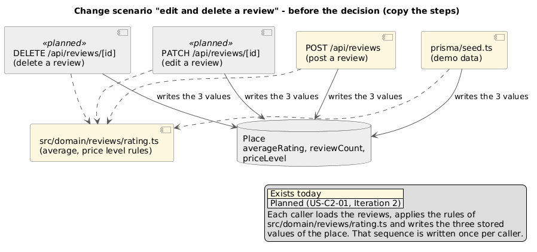
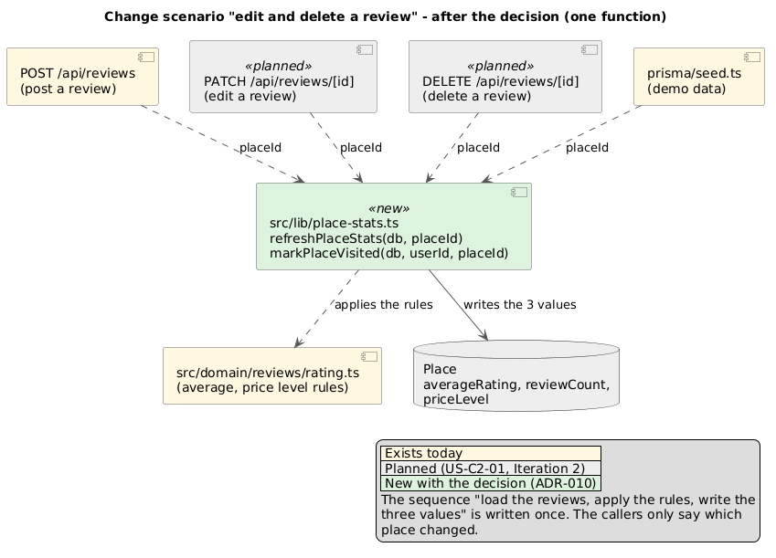

# Change scenario: edit and delete a review

Group 7 · MESW DOO 2026-27 · End of Iteration 1

This page documents one plausible future change, analyses the coupling and the cohesion of the code that
the change would touch, and records the design decision that follows. The decision is
[ADR-010](../design.md#adr-010-one-function-recomputes-the-stored-values-of-a-place).

## 1. The scenario

**US-C2-01 Edit and delete my review** (MVP feature C2, issues #39, #40 and #41, planned for Iteration 2).
A user can change the rating, price level or text of their own review, or delete it. Acceptance criteria that
matter here:

- after an edit or a delete, **the place's rating and price level are recalculated** (AC1, AC2);
- when the only review of a place is deleted, the place has no rating and no price level (AC3);
- a visit survives the deletion of the review (AC5).

The story already states the rule: "Recalculation uses the same functions as US-C1-01". The change is plausible
because it is in the MVP, and it is sensitive because the rating and price rules change often (see 3.3).

## 2. The design today

A place stores three values that are derived from its reviews: `averageRating`, `reviewCount` and `priceLevel`
(the domain model marks them `/derived`). The rules are pure functions in `src/domain/reviews/rating.ts`
(`calculateAverageRating`, `calculatePlacePriceLevel`). The sequence that uses them, "load the reviews of the
place, apply the rules, write the three values", exists in these places:

| Where                                                                           | What it does                                                                                    |
| ------------------------------------------------------------------------------- | ----------------------------------------------------------------------------------------------- |
| `POST /api/reviews` (`src/app/api/reviews/route.ts`)                            | Steps 5 and 6 of the handler, after creating the review                                         |
| `prisma/seed.ts` (`recalculateRatings`)                                         | The same sequence for the demo data, because the seed writes reviews straight into the database |
| The migration of #37 (`prisma/migrations/..._unique_review_per_user_and_place`) | The average and the count again, in SQL, once                                                   |

Marking the place as visited (the other policy of the Review aggregate, see the EventStorming) is written inline
in the same handler.

## 3. Coupling analysis

The three dimensions of Khononov, on the scales of the course (strength: contract, model, functional,
intrusive; distance D1 to D5; volatility V1 to V4). The "top-level packages" are `app`, `components`, `domain`,
`hooks`, `lib` and `types` under `src`, and `prisma` and `scripts` next to it.

### 3.1 The relationships

| #   | Relationship                                                                         | Strength   | Distance | Volatility | Verdict           |
| --- | ------------------------------------------------------------------------------------ | ---------- | -------- | ---------- | ----------------- |
| R1  | `POST /api/reviews` and `prisma/seed.ts`                                             | Functional | D4       | V4         | Worth redesigning |
| R2  | `POST /api/reviews` and the functions of `rating.ts`                                 | Contract   | D4       | V4         | Balanced          |
| R3  | The SQL of the migration and `calculateAverageRating`                                | Functional | D5       | V1         | Tolerable         |
| R4  | The future edit and delete handlers and `POST /api/reviews`, if the steps are copied | Functional | D3       | V4         | Worth avoiding    |

### 3.2 Evidence

- **R1. Strength:** both must know how the stored values of a place are derived from its reviews: which
  functions to apply, in which order, and which three columns to write. The formulas are shared, but the
  sequence is written twice, so a change of what is stored forces a change in both. That is functional coupling.
  **Distance:** `src/app/api/reviews/` and `prisma/` are different top-level packages (D4).
  **Volatility:** see 3.3 (V4).
- **R2. Strength:** the route passes arrays of numbers and strings and gets a value back. Nothing else is
  shared, so it is contract coupling. The volatility of the rules is absorbed here: the route does not change
  when a rule changes. Distance is D4 (`app` and `domain`), which is acceptable at this strength.
- **R3. Strength:** both must know the rule "mean of the ratings, rounded to one decimal, half up". The rule is
  written in TypeScript and in SQL, so it is functional coupling. **Distance:** a migration is not source code of
  the application (D5). **Volatility:** an applied migration never changes (V1). The product of the three is
  low: strong and far, but frozen.
- **R4.** If the sequence is copied into the two new handlers, three handlers must change together whenever
  the stored values change. They sit in `app/api/reviews` and `app/api/reviews/[id]` (D3). The rules are V4, so
  this is the relationship that would hurt most, and it does not exist yet: it is the scenario.

### 3.3 Volatility, from git

The rules behind the stored values changed five times between 2 and 5 Nov 2026 (`rating.ts`): the rating score
(#107, 2 Nov), a place without a price is unknown (#17, 3 Nov), the weight of the score from 3 to 6, rounding
half up, and a free place stays free until two reviews say it is paid (all 5 Nov). The reviews route changed
five times in the same days. That is more than once a month, so V4.

### 3.4 What this already cost

The policy "mark the place as visited when a review is posted" exists only inline in the handler. The seed
writes reviews without going through the handler, so the new demo data (6,549 reviews) came with no visit at all.
It was found on 5 Nov while reviewing the "Visited" badge of #38 and fixed in the seed of #20, before it reached
dev. The same thing
would happen to the next place that needs the policies: they are copied, not shared.

## 4. Cohesion analysis

**The handler `POST /api/reviews`** has seven reasons to run, in sequence: authenticate, validate the input,
create the place if it was found on the map, refuse a second review, create the review, mark the place visited,
recompute the three stored values. The steps are sequential (the output of one is the input of the next), but
they belong to two components of the component diagram. Creating the review is **Reviews**. Ingesting the place,
marking it visited and recomputing its values are policies of the **Place** aggregate, owned by **Place
Catalog**. The diagram says "Reviews calls Place Catalog"; the code says "one function does both". Cohesion is
therefore low at the level of the component, and edit and delete would repeat the steps that are not about reviews.

**`rating.ts`** is cohesive around the price level and the rating of a review (average, mode, score), but it
also holds the formatting of a price level for the screen (`formatPriceLevel`) and the cost points of a trip
(`calculateAverageCostPoints`, used by the itinerary). It is a candidate to split later. It is not part of this
decision, because splitting it would not reduce the copies of the sequence.

## 5. Options

| Option                                                                   | Effect on strength, distance, volatility                                                                        | Cost                                                                                         |
| ------------------------------------------------------------------------ | --------------------------------------------------------------------------------------------------------------- | -------------------------------------------------------------------------------------------- |
| A. Do nothing: copy the steps into the edit and delete handlers          | Functional coupling between four writers (R4 and R1), V4                                                        | Cheapest now, most expensive at each rule change                                             |
| B. One function that recomputes the three values, called by every writer | Functional becomes contract: each caller knows only "this place changed". V4 stays but is absorbed in one place | One module and one level of indirection                                                      |
| C. Compute the values in the database (trigger or view)                  | Moves a volatile rule into SQL, far from the tested domain code (D5), harder to test                            | A new technology for the rules, migrations on every rule change                              |
| D. Stop storing the values and compute them on read                      | Removes the sequence entirely                                                                                   | Every list, ranking and filter aggregates the reviews of thousands of places on each request |

## 6. Decision

**Option B** (ADR-010). One function in `src/lib/place-stats.ts` recomputes the three stored values of a place:
`refreshPlaceStats(db, placeId)`. Next to it, `markPlaceVisited(db, userId, placeId)` holds the visit policy.
The post handler, the future edit and delete handlers and the seed call them, passing their database client.
The formulas stay where they are, in `src/domain/reviews/rating.ts`, which stays pure and free of the database.
The migration of #37 stays as written, because it is frozen (R3).

The change is made when US-C2-01 is built, in Iteration 2, as its first step, so that edit and delete never
contain a copy.

Before and after:

### Why this is better balanced, not only more decoupled

- **Strength:** R1 and R4 go from functional to contract. The callers no longer know which functions to apply
  or which columns hold the values.
- **Distance:** it does not change. Callers stay where they are, and the knowledge now lives in one place, so
  the distance a change has to travel is one file.
- **Volatility:** it does not change. The rules still change often, but a change touches `rating.ts` and, if
  the stored values change, `place-stats.ts`, and nothing else.
- **Cohesion:** the policies of the Place aggregate leave the review handler, so the handler does what the
  Reviews component is for. The code follows the component diagram.

### Costs and risks

- One more module and one more level of indirection to read.
- Two requests that arrive together can still compute from a stale list of reviews. Today this is accepted. It
  is handled by running the function and the write in one transaction, which the new module makes possible in
  one place.
- The function needs the database, so it is tested with a database or with a fake client, not as a pure
  function.

### When to revisit

- The stored values are no longer enough (for example the rating score must be stored): the function grows.
  If it must run for thousands of places at once, option D or a scheduled job becomes worth discussing.
- `rating.ts` keeps growing with unrelated rules: split it (see section 4).
